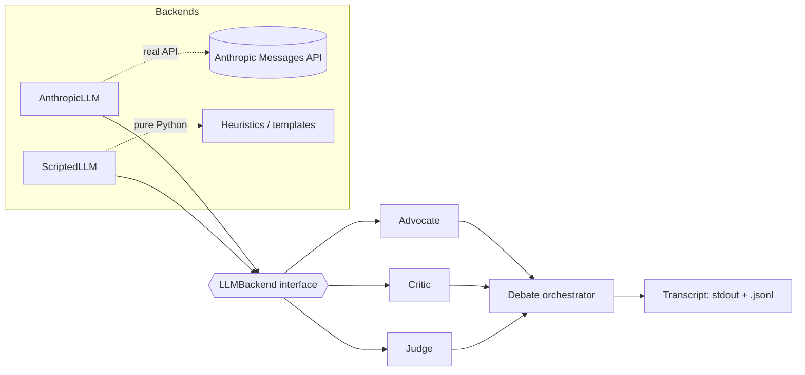

# Multi-Agent Debate

A framework for multiple LLM agents with **distinct roles** — an Advocate, a Critic, and a
Judge — that debate a question over configurable rounds to reach a better, checked answer
than any single pass would. No external tools, no retrieval, no ReAct loop: this project is
specifically about agent-to-agent argumentation improving answer quality, not about
tool-using agents.

## Motivation

A single LLM call answering a question gets one shot: whatever it outputs first is what you
get, including any snap-judgment error baked into that first pass. Structured multi-agent
debate is a way to add a second pass "for free," inside the system rather than outside it:

- An **Advocate** proposes and defends an answer.
- A **Critic** is explicitly incentivized to attack that answer — check it against the stated
  facts, look for unstated assumptions and contradictions — rather than agree with it.
- A **Judge** only sees the finished exchange and has to produce a final answer that survives
  the Critic's objections, with a rationale that says which objections it addressed.

This mirrors the general idea explored in work on multi-agent debate and self-critique for
LLMs (e.g. Du et al., *"Improving Factuality and Reasoning in Language Models through
Multiagent Debate"*, 2023, and related self-refinement / constitutional-critique literature):
giving a model (or models) an adversarial second look at its own reasoning can catch errors
that a single forward pass does not. This is **not** a universal fix — debate adds latency and
cost, can't invent facts nobody in the debate has, and a confidently wrong Critic can just as
easily derail a correct answer. The worked example below is a real, reproducible demonstration
of the mechanism working on one well-known case, not a claim that it always will.

## Architecture

```
                         ┌─────────────────────────────────────────┐
                         │                 Debate                   │
                         │         (orchestrator, N rounds)         │
                         └─────────────────────────────────────────┘
                                          │
            ┌─────────────────────────────────────────────────────┐
            │  for round in 1..N:                                   │
            │                                                        │
            │   ┌───────────┐   defends/refines    ┌───────────┐     │
            │   │ Advocate  │ ────────────────────▶│  Transcript│     │
            │   └───────────┘                       └─────┬─────┘     │
            │         ▲                                    │           │
            │         │ sees full history                  ▼           │
            │   ┌───────────┐     attacks           ┌───────────┐     │
            │   │  Critic   │ ────────────────────▶ │  Transcript│     │
            │   └───────────┘                       └───────────┘     │
            │                                                        │
            └─────────────────────────────────────────────────────┘
                                          │
                                          ▼
                                  ┌───────────┐
                                  │   Judge   │  synthesizes final answer,
                                  │           │  cites which Critic issues
                                  └───────────┘  (by round) were addressed
                                          │
                                          ▼
                              Final Answer + Rationale
                         (printed to stdout + written to .jsonl)
```

Each role (`Advocate`, `Critic`, `Judge`) is a thin wrapper around an `LLMBackend`. The
orchestrator (`Debate`) only knows how to sequence rounds and log messages — it has no
knowledge of *how* a role produces its text. That's the seam that makes two backends possible:



## Setup

Requires Python 3.11+.

```bash
python -m venv .venv
source .venv/bin/activate        # Windows: .venv\Scripts\activate
pip install -r requirements.txt
pip install -e .                 # installs the package itself, for the CLI entry point
```

## Running a debate

By default the CLI auto-selects the backend: it uses the real Anthropic API if
`ANTHROPIC_API_KEY` is set in the environment, and otherwise falls back to the deterministic,
offline `ScriptedLLM` backend. You can also force one explicitly with `--backend`.

```bash
python -m multi_agent_debate.run "Your question here" --rounds 2
```

Useful flags:

| Flag | Meaning |
|---|---|
| `--rounds N` | Number of Advocate/Critic rounds before the Judge speaks (default: 2). |
| `--backend {auto,scripted,anthropic}` | Force a backend (default: `auto`). |
| `--model NAME` | Override the Anthropic model name (only used with the real backend). |
| `--transcript PATH` | Write the debate transcript to a `.jsonl` file as it runs. |
| `--quiet` | Suppress the per-message stdout log; still prints the final answer. |

## Worked example: the bat-and-ball puzzle

This is a real, reproducible transcript from an actual run of this repository against the
offline `ScriptedLLM` backend (zero network calls) — not a hand-written mock. It uses the
classic "bat and ball" problem (Frederick, *Cognitive Reflection Test*, 2005), whose
intuitive, fast answer is subtly wrong.

Reproduce it yourself:

```bash
python -m multi_agent_debate.run \
  "A bat and a ball together cost \$1.10. The bat costs \$1.00 more than the ball. How much does the ball cost?" \
  --rounds 2 --backend scripted --transcript examples/bat_and_ball_transcript.jsonl
```

The committed output (also at [`examples/bat_and_ball_transcript.jsonl`](examples/bat_and_ball_transcript.jsonl)
and [`examples/bat_and_ball_transcript.txt`](examples/bat_and_ball_transcript.txt)):

```
[round 1] Advocate (advocate): My answer: the cheaper item costs $0.10. Reasoning: the two
items together cost $1.10, and since one costs $1.00 more than the other, subtracting that
extra $1.00 from the $1.10 total leaves $0.10 for the cheaper item.

[round 1] Critic (critic): Issue 1: the claimed value of $0.10 does not satisfy the stated
constraints. If the cheaper item costs $0.10, the other item would cost $1.10 ($0.10 + $1.00),
for a combined total of $1.20 -- not the stated $1.10. Solving the two equations simultaneously
(x + (x + 1.00) = 1.10) gives the consistent value $0.05.

[round 2] Advocate (advocate): Revised answer: the cheaper item costs $0.05. You're right that
my first answer was inconsistent. Letting x be the cheaper item's price, the pricier item is
x + $1.00, and together they must total $1.10: x + (x + 1.00) = 1.10, so x = $0.05.

[round 2] Critic (critic): No issues found: a value of $0.05 satisfies both constraints (it
sums to $1.10 together with the stated $1.00 difference).

[round 2] Judge (judge): Final Answer: $0.05
Rationale: the Critic's objection in round 1 -- that the naive answer of $0.10 (total minus
difference) contradicts the stated total once checked -- is correct and is addressed here.
Solving x + (x + $1.00) = $1.10 simultaneously gives x = $0.05; the Advocate's final answer
already reflects this correction.

======================================================================
FINAL ANSWER
======================================================================
$0.05
```

The Advocate's first instinct ($0.10) is the answer most people give — it's wrong, because it
implies a combined total of $1.20, not the stated $1.10. The Critic catches exactly that
contradiction, the Advocate concedes and re-derives the answer algebraically, and the Judge's
final answer ($0.05) reflects the correction with a rationale that names the round in which the
issue was raised.

## Switching to the real Anthropic backend

Set an API key and either pass `--backend anthropic` or rely on `--backend auto` (the default):

```bash
export ANTHROPIC_API_KEY=sk-ant-...        # Windows: set ANTHROPIC_API_KEY=sk-ant-...
python -m multi_agent_debate.run "Your question here" --rounds 2
```

`AnthropicLLM` defaults to `claude-opus-5` and can be pointed at another model with `--model`,
e.g. `--model claude-sonnet-5`. It uses the same `GenerationRequest` / role / round-history
contract as `ScriptedLLM`, so nothing else in the orchestration changes when you switch
backends — only how each message's text gets produced.

```python
from multi_agent_debate import AnthropicLLM, Debate

debate = Debate(AnthropicLLM(model="claude-sonnet-5"), rounds=2)
result = debate.run("Your question here")
print(result.final_answer)
```

## Testing

All tests run against the deterministic `ScriptedLLM` backend (or an injected fake Anthropic
client for the `AnthropicLLM` request/response tests) — **zero network calls, no API key
required**.

```bash
pip install -r requirements.txt
ruff check .
pytest -q
```

Test coverage includes:

- `tests/test_scripted_llm.py` — the rule-based backend's heuristics: puzzle detection, the
  naive vs. correct arithmetic, the Advocate's wrong-then-revised answers, and the Critic's
  flaw detection, for both the worked puzzle and the generic fallback path.
- `tests/test_agents.py` — each role's request-building and reply-plumbing logic.
- `tests/test_judge.py` — the Judge's synthesis logic specifically: independent verification,
  citing the Critic's issues by round, and correct behavior even when the Advocate never got a
  chance to revise within the debate.
- `tests/test_debate.py` — the round-orchestration loop: correct sequencing, correct round
  count, transcript structure, and `.jsonl` persistence.
- `tests/test_end_to_end.py` — full debate runs via `ScriptedLLM`, asserting a sane
  final-answer structure, including the worked example's actual corrected value.
- `tests/test_llm.py` — `AnthropicLLM`'s request/response handling against an injected fake
  client (model, system prompt, message content, text-block extraction, refusal handling).
- `tests/test_cli.py` — argument parsing, backend selection, and a full CLI run.

## Project structure

```
multi-agent-debate/
├── .github/workflows/ci.yml       # lint + test on push/PR
├── examples/
│   ├── bat_and_ball_transcript.jsonl   # real transcript from an actual run
│   └── bat_and_ball_transcript.txt     # the same run's stdout log
├── src/multi_agent_debate/
│   ├── __init__.py                # public API re-exports
│   ├── agents.py                  # Advocate / Critic / Judge role definitions
│   ├── debate.py                  # Debate orchestrator (round loop, transcript, final answer)
│   ├── llm.py                     # LLMBackend interface + AnthropicLLM
│   ├── scripted_llm.py            # ScriptedLLM: deterministic, offline, rule-based backend
│   ├── run.py                     # CLI entry point
│   └── transcript.py              # Message / DebateResult + JSONL persistence
├── tests/                         # pytest suite (see Testing)
├── pyproject.toml
├── requirements.txt
├── LICENSE
└── README.md
```

## License

MIT — see [LICENSE](LICENSE).
